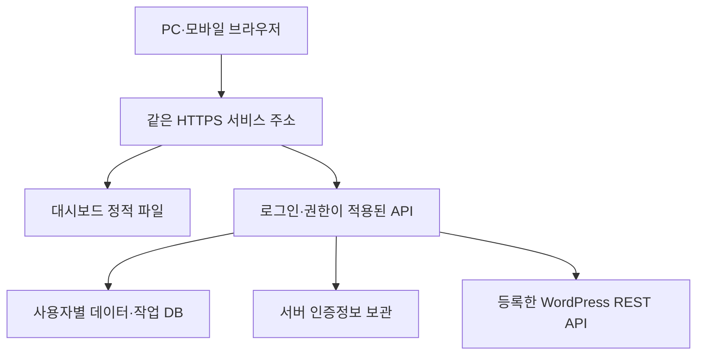

# ZERO SEO OS 중앙 운영 전환 설계

2026-11-13 · 사용자 검토용 제안 · 구현·배포 완료 문서가 아님

최신 사용자 선택: 첫 운영은 본인용 비공개, 제공자는 Cloudways. 특정 상품·서버·서비스 주소와 Python API 운영 방식은 미확정이다. [Cloudways 운영 조건 조사](Cloudways-운영조건.md)에 공식 지원 제약과 다음 확인을 기록했다. 이 문서의 FastAPI/PostgreSQL 등은 여전히 후보이며 Cloudways에서 그대로 실행 가능하다고 가정하지 않는다.

## 해결할 문제와 현재 위치

목표는 PC마다 Python과 화면 서버를 실행하는 과정을 없애고, 같은 서비스 주소에 로그인하면 같은 사이트·키워드·작업을 이어 쓰게 만드는 것이다. 현재 기술 주 단계 A-02의 화면·흐름·완료 조건을 정리하고, A-01 데이터·권한 설계와 A-03/A-04 연결 기능을 중앙 운영에 연결하는 제안이다. 기존 사업 전체 01~13과 번호를 합치지 않으며, 전체 A-04 또는 SaaS 완성을 선언하지 않는다.

현재 실제 증거는 사용자 PC의 A-1 인증·capability 성공, 초안 738 생성·재조회·동일 ID 재사용이다. 서버 코드 버전은 v0.2.5, 사용자 PC 화면 캡처는 v0.2.2다. GitHub 화면 소스에는 v0.2.3 기능이 있으므로 사용자의 설치 화면에 저장소 최신 기능이 모두 반영됐다고 가정하지 않는다.

| 질문 | 현재 로컬 방식 | 제안하는 중앙 운영 |
|---|---|---|
| PC를 바꾸면? | 프로그램·데이터·설정 이관 필요 | 같은 주소에 로그인 |
| 서버 창은? | 화면·연결 서버 두 창 필요 | 운영 서버가 계속 실행 |
| 데이터 기준은? | 해당 브라우저와 로컬 DB | 사용자별 서버 DB |
| 앱 비밀번호는? | 실행 때마다 입력, 프로세스 메모리 | 서버에서 암호화 보관, 화면에 재표시하지 않음 |
| 중복 방지 기록은? | PC의 .state 파일 | 중앙 DB의 영속 작업 기록 |
| GitHub 역할은? | 코드 보관 | 계속 코드 보관. 고객 데이터·인증정보 저장소가 아님 |

## 권장 전환 순서

첫 중앙 버전은 운영자 본인용 비공개 서비스로 검증하고, 고객 계정 도입 전 사용자 간 데이터 격리를 검증하는 점진 전환을 제안한다. 다만 본인용이라도 인터넷에 노출되는 API에는 로그인·인가가 필요하다. 개인용이라는 이유로 무인증 서버를 공개하지 않는다.

React 화면과 WordPress 연결 핵심 함수는 재사용한다. 현재 http.server Handler는 로컬 개발용으로 유지하고, 중앙 서비스에는 인증·운영·프로세스 관리가 가능한 웹 계층을 별도로 붙이는 안을 제안한다. FastAPI는 후보이며 아직 확정·교체하지 않았다. 사용자가 이전에 실행한 FastAPI와 달리 GitHub 현재 소스는 표준 라이브러리 HTTP 서버다.

대시보드와 API는 같은 HTTPS 출처의 상대 경로 `/api/...`로 연결하는 안을 권장한다. 현재 하드코딩된 127.0.0.1:8765를 고객 브라우저에서 호출하는 방식은 중앙 서비스에 사용할 수 없다. 현재의 로컬 Host·Origin 제한을 단순히 모든 출처 허용으로 바꾸어 해결하지 않는다.

## 화면에서 사용할 기본 흐름

1. 로그인 후 내 작업 공간에 들어간다.
2. 사이트 이름·주소를 등록한다. 이때 상태는 `등록됨·미검증`이다.
3. 사이트 연결 화면에서 WordPress 사용자명·앱 비밀번호를 HTTPS로 서버에 전달한다. 서버가 비밀 저장을 완료한 사실과 실제 인증 결과를 구분한다.
4. 서버가 인증된 사용자를 조회하고 사이트·사용자·확인 시각·credential revision을 검증한 뒤 `인증 확인`을 표시한다.
5. 글 작성·발행 capability를 별도로 표시한다. capability 있음이 실제 글 저장·공개 발행 성공이라는 뜻은 아니다.
6. 테스트 초안은 사용자가 명시한 대상·제목·내용을 확인한 후 1회 요청한다. `draft`로 생성하고 같은 ID를 재조회해야 저장 확인으로 표시한다.
7. 다시 누르면 저장된 ID를 조회한다. 불확실한 저장 결과는 자동 재생성하지 않고 확인 대기로 남긴다.
8. 다른 PC에 로그인해 동일한 사이트·키워드·작업·초안 ID가 조회되는지 확인한다.

연결 주소나 인증정보를 바꾸면 이전 확인 결과는 최신 자격을 보증하지 않는다. 성공 이력은 남기되 현재 연결 상태는 미검증으로 돌린다. 비밀번호는 응답·브라우저 저장소·로그·JSON 백업·GitHub에 넣지 않는다. 인증정보 입력창 값은 제출 후 비우고 서버는 비밀 저장 참조와 `등록됨` 여부만 반환한다.

## 데이터 모델 제안

| 개체 | 핵심 필드·관계 | 반드시 지킬 조건 |
|---|---|---|
| 작업 공간 | id, 소유자, 생성 시각 | 서버 세션에서 접근 가능한 공간을 결정 |
| 구성원 | workspace_id, user_id, 역할 | 첫 본인용 운영 이후 고객 도입 전 격리 검증 |
| 사이트 | id, workspace_id, display_slot, name, canonical_url, revision | A-1/A-2는 표시 슬롯. 중앙 영구 ID와 구분 |
| 인증정보 | site_id, secret_ref 또는 암호문, key_version, credential_revision | 키·비밀 원문은 DB 덤프나 소스에 함께 넣지 않음 |
| 키워드 | id, workspace_id, site_id, keyword, created_at | 사이트·소유자 복합 참조 검증, 필요 시 중복 정책 확정 |
| 작업 | id, workspace_id, site_id, keyword, status, revision, 시각 | 기존 상태·ID를 가져오며 자동 실행하지 않음 |
| 연결 확인 | site_id, credential_revision, result, checked_at | 결과 시점과 현재 자격 버전 일치 확인 |
| 초안 시도 | workspace_id, site_id, purpose, attempt_id, 상태, wp_post_id | 네트워크 전 intent 영속 저장. 불확실 시 재작성 차단 |
| 이관 기록 | import_id, owner, 출처 fingerprint, 요약, 검증 결과 | 반복 가져오기 중복 검출, 기존 기록 보존 |
| 감사 기록 | actor, workspace, action, target_id, result, 시각 | 비밀번호·Authorization·원문 응답 제외 |

중앙 DB는 여러 API 프로세스가 트랜잭션을 공유할 수 있는 관계형 DB를 후보로 둔다. PostgreSQL 등 실제 제품과 호스팅은 운영 환경 확인 후 확정한다. 현재 SQLite 파일을 공유 네트워크 폴더에 올려 다중 서버 DB로 쓰는 방식으로 확장하지 않는다.

브라우저가 workspace_id 또는 site_id를 전송해도 그것만 신뢰하지 않는다. 모든 조회·변경은 서버 세션의 소유권 범위에서 대상 사이트와 작업을 확인한다. 사이트 번호 A-1을 아는 것만으로 다른 고객 A-1에 접근할 수 없어야 한다.

## API 계약 초안

아래는 새 중앙 API 제안이다. 현재 구현된 `/api/sites/verify`, `/api/sites/permissions`, `/api/sites/test-draft`, `/api/storage`와 혼동하지 않는다.

| 동작 | 경로 예시 | 성공 기준·실패 처리 |
|---|---|---|
| 현재 로그인·공간 | GET /api/v1/session | 미로그인 401, 역할·공간 최소 정보 |
| 사이트 목록·등록 | GET/POST /api/v1/sites | 등록과 인증 완료를 구분 |
| 인증정보 교체 | PUT /api/v1/sites/{id}/credential | 본인 권한·CSRF 확인, 새 revision, 원문 반환 없음 |
| 연결·권한 확인 | POST /api/v1/sites/{id}/verify | 서버 DB의 URL·자격 사용. 임의 URL·비밀번호를 body에서 받아 대리 요청하지 않음 |
| 키워드·작업 | /api/v1/sites/{id}/keywords, /jobs | 사이트별 소유권 확인, revision 충돌 시 덮어쓰기 거부 |
| 초안 요청 | POST /api/v1/sites/{id}/test-draft | 사용자 확인·중복키·intent 기록, status=draft만 허용 |
| 초안 상태 | GET /api/v1/sites/{id}/test-draft | 기록된 ID 재조회만 하며 새 글을 생성하지 않음 |
| 백업·가져오기 | /api/v1/exports, /imports | 검사→미리보기→사용자 확인→트랜잭션 적용 |
| 상태·버전 | GET /api/health | 비밀 없는 버전·서비스 상태, 상세 점검은 로그인 필요 |

쿠키 세션을 쓰면 HttpOnly·Secure·SameSite와 상태 변경 요청의 CSRF 검증을 함께 설계한다. 서비스 인증은 검증된 구성요소를 우선 검토하며 임의 JWT·자체 비밀번호 저장 방식을 급히 추가하지 않는다. 외부 인증 서비스 사용 여부와 로그인 방식은 검토 후 확정한다.

## 인증정보와 외부 요청

- 서버 비밀 저장소 또는 인증된 암호화 방식을 사용한다. 암호화 키는 DB·Git·프론트엔드 빌드와 별도 보관하고 key version·백업·복구·회전 절차를 설계한다. 키가 없어진 DB는 비밀을 복호화하지 못한다는 점을 운영 문서에 남긴다.
- 브라우저에 비밀을 저장하지 않는다는 원칙은 비밀번호 입력 폼 자체를 금지한다는 뜻이 아니다. 중앙 서비스에서는 사용자가 자신의 브라우저에서 HTTPS로 서버에 한 번 제출하는 흐름이 필요하다. 응답은 마스킹 표시와 등록 여부만 제공한다.
- 허용된 사이트 URL, HTTPS, 공개 IP 검사, 검증된 DNS IP로 연결 고정, 인증서 호스트 검증, 리다이렉트 거부를 유지한다.
- 초안 결과나 오류에 상위 WordPress 응답 전체를 노출하지 않는다. 오류 코드와 안전한 안내만 전달한다.
- WordPress capability는 조회 시점 기준이다. 자동 공개·예약 발행은 이번 전환 범위에 넣지 않는다.

## 초안 중복 방지와 시간 초과

중복 기준은 사용자 공간·등록 사이트·테스트 목적을 포함해야 한다. 다른 고객의 동일 URL 기록을 무인증으로 공유하지 않는다. 연결을 다시 등록해도 같은 공간의 같은 실제 사이트로 새 테스트를 무조건 생성하지 않도록 canonical URL과 사이트 이력을 함께 확인한다.

DB 트랜잭션에서 intent를 먼저 확정하고 네트워크 요청은 한 번 수행한다. 응답을 잃으면 `결과 불확실` 상태를 남긴다. 사용자 브라우저 시간 초과나 새로고침은 WordPress 작업 취소를 뜻하지 않는다. 새 글로 자동 재시도하지 않는다. 여러 프로세스의 동시 클릭도 DB 유일성·행 잠금 등으로 한 번만 작성되게 검증해야 한다.

중앙 서비스에서는 UI의 초안 `상태 확인` API를 읽기 전용으로 분리한다. 현재 로컬 API는 저장·재사용을 한 함수에서 처리하므로 기존 DB 기록이 사라진 상태에서는 같은 동작이 새 글 생성으로 이어질 수 있다.

## 기존 데이터 이관과 복구

현재 사용자 PC의 파일은 이 Work에 없으며 백업 완료 증거도 없다. 사용자 부재 중 이를 대신 이관했다고 주장하지 않는다.

| 원본 | 중앙으로 가져올 것 | 보존·검증 방법 |
|---|---|---|
| JSON v1 | A-1/A-2 키워드·작업 | 사이트 이름·주소는 포함되지 않으므로 별도 매핑 |
| JSON v2 | 키워드·작업·사이트 이름·주소 | credential과 초안 DB는 포함되지 않음 |
| test-drafts.sqlite3 | 초안 intent, ID, 확인·불확실 상태 | 온라인 DB는 SQLite backup API 등 일관된 복사 사용. 원본은 보존 |
| workspace.sqlite3 | 수동 저장본 이력 | v2 파일과 중복될 수 있으므로 fingerprint·가져오기 이력 확인 |
| 프로세스 자격 | 자동 이관 대상 없음 | 사용자가 중앙 HTTPS 화면에서 새로 등록 |

이관은 원본 복사→형식 검사→사이트 매핑→개수·충돌 미리보기→확인→한 트랜잭션 적용→다른 PC 조회 확인 순서로 진행한다. 실패하면 중앙 변경을 롤백하고 원본 파일·브라우저 데이터를 유지한다. 같은 파일 반복 가져오기를 무조건 중복 등록하지 않는다.

과거 데스크톱 초안 737과 이번 PC 초안 738은 실제로 서로 다른 기록이다. 가져오기 중 하나를 삭제하거나 최신 ID만 임의 선택하지 않는다. 두 이력을 보존하고 사이트별 대표 테스트 기록을 명시적으로 정한다. 이미 게시된 WordPress 글을 이관 도구가 자동 삭제하거나 재생성하지 않는다.

백업에는 DB 스키마 버전·사이트 매핑·작업·초안 이관 기록이 필요하다. 자격 비밀은 일반 JSON에서 제외한다. 운영 전체 복구는 암호화 DB·키·배포 버전·비밀 저장소 복구 가능성까지 포함해 별도 검증한다. 백업 주기·보관 기간·복구 목표는 사용자의 운영 조건과 비용을 보고 결정하며 아직 자동화하지 않았다.

## 실행 순서와 완료 조건

| 순서 | 개발 묶음 | 완료 증거 |
|---|---|---|
| 1 | A-02 화면·상태·버전 기준 확정 | 다음 문서의 화면별 기능·완료 조건 합의 |
| 2 | 중앙 운영 범위 결정 | 첫 운영자용/고객용 범위, 로그인·호스팅·DB 선택 |
| 3 | 로그인·소유권과 서버 저장 구현 | 미로그인 차단, 두 사용자 교차 접근 차단 테스트 |
| 4 | 사이트·비밀 저장과 WordPress 연결 이전 | 비밀 미노출, 자격 교체 시 검증 초기화, 실제 사이트 승인 후 확인 |
| 5 | 키워드·작업 API와 기존 UI 연결 | PC 두 대·브라우저 두 개에서 같은 서버 데이터 확인 |
| 6 | 가져오기·백업·초안 이력 이전 | v1/v2/.state 실제 복사본으로 수량·ID·롤백 확인 |
| 7 | 비공개 배포·운영 검증 | PC 터미널 종료 후 접속, 서버 재시작 후 기록 유지·복원 시험 |
| 8 | 고객 사용 전 격리·동시성 검증 | 사용자 간 비밀·작업·사이트 격리, 동시 클릭 단일 작성 |

추천안은 현재 코어를 재사용하는 중앙 API 방식이다. 다만 프레임워크·호스팅·DB·인증·실제 계정 생성과 배포는 다음 검토 후 결정한다. 기존 Cloudways 사용 이력만으로 해당 서버에 상주 Python 프로세스나 DB 운영 권한이 있다고 가정하지 않는다. 실제 제품·가격·권한은 선택 시 공식 정보와 계정 상태로 확인한다.

운영자 본인용 비공개와 Cloudways 제공자 선택은 확인됐다. 다음은 현재 Cloudways 상품·서버의 지원 조건과 서비스 주소를 확인하는 것이다. Python 운영이 지원되지 않으면 PHP 이식 또는 별도 Python API 환경은 주요 변경이므로 사용자와 합의한 뒤 착수한다. 회원 유료화·결제·AI 작업 자동 실행은 이번 문서에서 확정하지 않는다.
